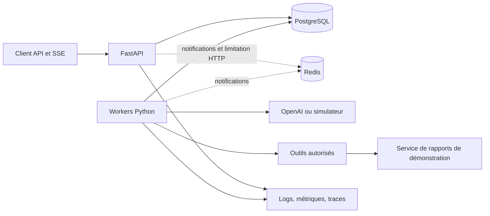

# AI Task Execution Platform — architecture et plan d’implémentation

Révision : 2026-10-14, après revue indépendante. **Statut : proposition révisée à valider ; aucune implémentation autorisée.**

Ce document remplace le plan fourni dans la conversation. Il conserve le MVP choisi et ses sept milestones. La [revue indépendante](../reviews/architecture-plan-review.md) reste inchangée ; la [réponse finding par finding](../reviews/architecture-plan-review-response.md) explique les arbitrages. Les garanties ci-dessous sont des contrats à tester, pas des résultats acquis.

## 1. Périmètre, architecture et garanties

### 1.1 MVP retenu

- Backend multi-utilisateur, clés API, isolation par propriétaire et quotas ; comptes provisionnés par CLI, sans organisations ni facturation client.
- Catalogue de workflows versionnés en code, étapes séquentielles et boucles d’agent bornées ; plusieurs tâches concurrentes entre workers.
- Outils de lecture et un service de rapports de démonstration avec écriture idempotente.
- OpenAI Responses derrière un adaptateur limité, précédé d’un simulateur déterministe.
- Suspension par défaut d’une génération LLM au résultat incertain ; nouvelle génération seulement sur décision explicite et dans les limites restantes.
- Docker Compose exploitable sur un serveur ; pas de haute disponibilité.

Le workflow de référence analyse des textes fournis, consulte un corpus autorisé, produit un rapport structuré, puis l’enregistre par une étape déterministe. Les sources, réponses et rapports restent des contenus non fiables.

### 1.2 Composants

| Composant | Responsabilité |
|---|---|
| API | Authentification, commandes idempotentes, lectures autorisées, contrôle et SSE. |
| Services applicatifs | Transactions, autorisations, transitions couplées et création de la prochaine unité. |
| Runtime d’agent | Contexte versionné, interprétation des réponses, validation des tool calls et bornes d’exécution. |
| Workers | Claim, exécution, heartbeat et récupération ; une boucle de maintenance dans les mêmes processus traite expirations et reprises. |
| PostgreSQL | Source de vérité : file, états, résultats, permissions, budgets, événements et audit. |
| Redis | Réveils éphémères et limitation du trafic HTTP ; aucune responsabilité de correction durable. |
| Adaptateurs | Traduction des protocoles LLM/outils ; ni décisions de workflow ni retries cachés. |

Un dépôt, une image applicative et trois commandes `api`, `worker`, `admin`. Le service de démonstration simule une vraie frontière HTTP et possède ses propres données et identifiants d’accès. Pas de microservices métier.

### 1.3 Garanties et limites

| Contrat | Domaine de validité |
|---|---|
| `202` après commit de la tâche, du travail et de sa réponse idempotente | PostgreSQL configuré avec commits durables ; un acquittement perdu se résout par relecture. |
| Rejeu de commande sans nouvelle tâche | Même propriétaire/route/clé et requête, dans la rétention définie ; authentification toujours valide ; historique non perdu par restauration. |
| Une seule progression locale acceptée | Vérification atomique état/version/bail/génération ; étapes suivantes et événements dans le même commit. |
| Reprise après crash ordinaire | État PostgreSQL conservé, workers et maintenance disponibles ; une issue correcte peut être `suspended` ou `timed_out`. |
| Pas de génération automatique répétée après ambiguïté | Toutes les couches de transport respectent la politique ; une autorisation déjà commitée peut encore produire son premier envoi tardif. |
| Un effet de démonstration par clé d’opération | Déduplication distante transactionnelle, même contenu, horizon respecté. Aucune garantie entre deux nouvelles tâches de clés différentes. |
| Révocation | Empêche les autorisations de dispatch ordonnées après son commit ; ne révoque pas une autorisation déjà commitée, même pas encore transmise. |
| Budget local | Réservations atomiques tâche/propriétaire/déploiement ; aucune garantie exacte de facture ou de tokens réels du fournisseur. |
| SSE | Ordre par tâche, snapshot cohérent, rejeu pendant rétention ou reset explicite ; doublons possibles, pas d’acquittement métier implicite. |
| Sauvegarde quotidienne | Objectif RPO 24 h, pas zéro perte après sinistre ; historique d’acceptation postérieur à la sauvegarde potentiellement perdu. |

Pas d’exécution physique exactly-once, de fencing distant implicite, d’immunité aux prompt injections ou de garantie de vérité des rapports. Isolation contre les appelants API, pas contre un administrateur ou un rôle SQL applicatif compromis.

## 2. Données, invariants et transitions couplées

### 2.1 Modèle minimal

UUID, `timestamptz` UTC, montants entiers en micro-USD ; colonnes relationnelles pour invariants et index, JSONB validé pour contenus. Les plafonds sont non négatifs, mais une consommation réelle peut dépasser son plafond et doit être enregistrée.

| Entité | Données essentielles |
|---|---|
| `platform_control` | Ligne unique : époque d’exploitation, dispatch ouvert/fermé, plafonds globaux et compteurs d’admission. |
| `principals`, `api_keys` | Propriétaire, statut, versions de permissions, empreintes de clés, quotas et compteurs. |
| `workflow_versions` | Définition, prompts, schémas d’outils, context builder et handler immuables ; disponibilité pour nouvelles tâches séparée. |
| `documents` | Propriétaire, version immuable, texte/empreinte, droits de lecture révocables ; corpus sélectionné par versions à la création. |
| `tasks` | Propriétaire, clé ayant autorisé le travail, version de workflow, entrée figée, état/version, deadline, limites et résultat terminal. |
| `steps` | Unités exécutables créées à la demande : chemin unique, type, état, disponibilité, résultat, génération et bail ; clé/contenu d’opération stables pour l’écriture. |
| `attempts` | Une acquisition de travail : worker, génération, début/fin, état et motif ; historique conservé. |
| `external_calls` | Une autorisation de transmission : UUID créé avant B, tentative, payload exact, empreinte, époque/permissions, destinataire, identifiant fournisseur, état et preuves. |
| `budget_accounts`, `call_costs` | Comptes globaux/propriétaire/tâche et une provision par `external_call_id` ; coût/tokens confirmés, exposition restante, tarif/tokenizer et révision. |
| `provider_admission` | Compteurs partagés PostgreSQL par projet/modèle, limites de requêtes/tokens et appels locaux actifs. |
| `task_events`, `idempotency_records`, `audit_events` | Séquence publique, réponses de commandes versionnées, décisions administratives et observations comptables dédupliquées. |

Un tour devient des unités `analysis/turn-1/model`, `analysis/turn-1/tool`, etc. Pas de coroutine dont la mémoire constituerait le seul checkpoint.

### 2.2 Propriétaire de chaque invariant

- SQL : clés étrangères incluant le propriétaire aux frontières utiles, unicité `(task_id, step_path)`, `(step_id, attempt_number)`, `(task_id, event_sequence)` et `(principal_id, route, idempotency_key)`.
- Index partiels : au plus une tentative `active` par étape, et une étape dans `{ready, running, retry_wait, unknown}` par tâche. Aucun prédicat d’index dépendant de l’heure ; une expiration doit être traitée explicitement.
- Services : décisions de transition, autorisation, limites, création de la suite et événements atomiques. Adapters : protocoles uniquement.
- Triggers ciblés : arcs autorisés et immutabilité du résultat terminal ; ils ne planifient ni outils ni étapes. Les métadonnées de coût et preuves tardives ne sont pas le résultat terminal.
- Toute mutation métier vérifie état et version attendus. Zéro ligne modifiée = conflit. Un succès produit une seule incrémentation de version et les événements associés.

### 2.3 États

| Objet | Transitions autorisées |
|---|---|
| Tâche | `queued → running / suspended / failed / cancelled / timed_out` ; `running → succeeded / failed / suspended / cancelled / timed_out` ; `suspended → queued / succeeded / failed / cancelled / timed_out`. Les quatre états terminaux sont immuables. |
| Étape | `ready → running` ; `running → succeeded / retry_wait / failed / unknown` ; `running → ready` uniquement pour désaffectation avant B, sans appel autorisé ; `retry_wait → ready` ; `unknown → ready / succeeded / failed` ; toute étape non terminale peut devenir `cancelled`. |
| Tentative | `active → succeeded / failed / expired / revoked` ; aucun retour vers `active`. Une tentative terminée ne change plus, des preuves peuvent lui être rattachées. |
| Appel | Créé directement `authorized` en B ; `authorized → succeeded / rejected / unknown` ; `unknown → succeeded / rejected` sur preuve validée. Un nouveau dispatch est une nouvelle ligne, pas la réouverture de l’ancienne. |

`rejected` signifie réponse de rejet connue, pas nécessairement gratuité. L’issue protocolaire et l’état de comptabilisation sont distincts. Les états `pending`, `prepared` et `cancelling` sont supprimés : unités créées paresseusement, autorisation et provision atomiques, annulation locale immédiate.

### 2.4 Matrice de transitions couplées

Toutes les lignes opèrent sur l’état/version relus sous verrou. Un worker normal exige en plus bail non expiré, détenteur, génération et époque valides. L’API, le récupérateur et la CLI ont leurs préconditions propres ; ils ne se font jamais passer pour un ancien détenteur de bail.

| Action / acteur | Préconditions | Modifications atomiques | Coûts et événement |
|---|---|---|---|
| Création / API | Commande neuve admise | Tâche `queued`, première étape `ready` | Pas de provision d’appel ; `task.created`. |
| Claim / worker A | Tâche exécutable, étape `ready`, handler compatible | Tâche `running`, étape `running`, tentative `active`, nouveau bail/génération | `step.started`. |
| Autorisation / worker B | Bail valide, droits actuels, délai et capacités suffisants | Appel `authorized`, identité/payload figés, compteurs de dispatch incrémentés | Provision argent/tokens et slot local ; `call.authorized`. |
| Succès / worker C | Propriété courante, appel sélectionné pour l’étape | Étape/tentative réussies, prochaine étape `ready` ou tâche réussie | Settlement si usage connu ; `step.succeeded`, éventuel `task.succeeded`. |
| Rejet temporaire prouvé / worker C | Pas d’exécution incertaine, limites restantes | Tentative `failed`, étape `retry_wait`, puis maintenance `ready` à échéance | Comptabilisation de l’usage connu, même nul seulement si établi ; `step.retry_scheduled`. |
| Échec définitif / worker ou résolveur | Preuve définitive ou limite atteinte | Étape `failed`, tâche `failed`, aucune suite | Provision conservée si usage inconnu ; `task.failed`. |
| Perte de bail avant B / récupérateur | Expiration constatée sous verrou, aucun appel autorisé | Ancienne tentative `expired` avant nouvelle éligibilité ; étape `retry_wait` ou échec si limites | Aucune provision ; `step.recovered`. |
| Perte après B / récupérateur | Appel non résolu | Tentative `expired`, appel/étape `unknown`, tâche `suspended` | Provision maintenue, slot local libéré ; `task.suspended`. |
| Timeout réseau ambigu / worker | Appel autorisé, pas de preuve définitive | Tentative `failed`, appel/étape `unknown`, tâche `suspended` | Provision maintenue ; `task.suspended`. |
| Annulation / API | Tâche non terminale, commande autorisée | Tâche `cancelled`, toutes étapes non terminales `cancelled`, tentative active `revoked`, génération invalidée ; appels autorisés non résolus `unknown` | Ne libère aucune provision incertaine ; `task.cancelled`. |
| Deadline / maintenance ou commande | Heure DB ≥ deadline, tâche non terminale | Même nettoyage que l’annulation, tâche `timed_out` | `task.timed_out` ; pas de prolongation implicite. |
| Nouvelle génération LLM / propriétaire | Tâche suspendue, version attendue, risque accepté, deadline/limites restantes | Ancienne tentative close et ancien appel immédiatement désélectionné ; étape `unknown → ready`, tâche `queued` ; ancien appel conservé, nouveau call créé seulement au prochain B | Ancienne provision maintenue, future réservation indépendante ; `task.resumed`. |
| Réconciliation définitive / résolveur | Preuve liée à l’identité d’appel ; tâche encore suspendue et même appel sélectionné | Étape `succeeded` puis suite `ready` et tâche `queued`, ou tâche `succeeded` si dernière unité ; rejet définitif → tâche `failed` | Settlement idempotent ; `call.reconciled` et événement de tâche. |
| Preuve tardive / service de réconciliation | Ancien appel, tâche terminale ou génération remplacée | Appel et comptabilité seulement ; aucun résultat terminal ni sélection de continuation changé | `usage.updated`, audit de preuve ; aucun redémarrage. |
| Handler/droits indisponibles / maintenance ou B | Pas de dispatch autorisable | Tentative active `revoked` s’il y en a une, étape non envoyée remise/retenue `ready`, tâche `suspended` avec raison | `task.suspended` ; la tâche n’est plus claimable. |

Une suspension peut donc porter une étape `unknown` ou `ready`, toujours avec une raison et une action de résolution explicites. La restitution des droits ou d’un handler exige un `resolve` autorisé et une revalidation ; aucune sortie de suspension par hasard. Une quarantaine de restauration requiert d’abord une levée administrative fondée sur les preuves du §5.3 ; le propriétaire ne peut la contourner avec `resolve`. Les retries sûrs d’un outil idempotent peuvent être résolus par la maintenance, selon §3.4.

Le deadline check précède toute progression ou décision d’annulation après acquisition des verrous. Un succès accepté avant la deadline peut finir son commit après celle-ci ; sinon la tâche expire. L’ordre des transactions détermine une unique issue terminale. Les appels tardifs restent comptabilisés.

## 3. Commandes, transactions, agents et SSE

### 3.1 Idempotence et admission

`POST /v1/tasks` exige `Idempotency-Key`, un nom/version de workflow, une entrée et éventuellement des limites plus basses que celles du serveur.

1. Authentifier la clé actuelle et le propriétaire ; limiter la taille et parser strictement le JSON, sans clefs dupliquées ni nombres non finis.
2. Rechercher la commande existante avant les contrôles propres à une nouvelle tâche. Canonicalisation versionnée `v1` : ordre des clés d’objet ignoré, ordre des listes et chaînes conservé, nombres normalisés par représentation décimale ; absence et `null` restent différents. Ne pas injecter de valeurs serveur par défaut dans cette empreinte.
3. Si la commande existe, utiliser sa version de canonicalisation, vérifier propriétaire et empreinte puis rejouer le statut/corps d’origine, ou `409` en cas de collision. Une clé révoquée n’obtient pas ce rejeu. Le retrait d’un workflow, un budget saturé ou cinq tâches ouvertes ne changent pas un rejeu valide.
4. Si absente, verrouiller les lignes globales/propriétaire dans l’ordre §3.2, revalider l’authentification et rechercher à nouveau la clé. Seulement ensuite vérifier époque, disponibilité du workflow, schéma complet, droits documentaires, quotas et stockage.
5. Résoudre et enregistrer les valeurs effectives, créer tâche/étape/événement/réponse, consommer les quotas dans une transaction. Renvoyer `202` après commit.

La sérialisation du propriétaire empêche deux clés distinctes de consommer la dernière place. L’unicité de la clé protège les doublons. La limitation anti-abus borne même les replays, sans les faire passer par l’admission métier nouvelle. Durant une panne Redis, un replay existant reste accessible sous les limites de lecture ; une nouvelle commande de création reçoit `503`.

### 3.2 Transactions, ordre des verrous et révocation

Isolation `READ COMMITTED`. Ordre global pour toute transaction ayant besoin de plusieurs catégories :

`platform_control / compte global → principal / compte propriétaire → api_key → workflow_version → droits documentaires triés → provider_admission → task / compte tâche → step → attempt → external_call → call_costs`.

Dans une catégorie, tri par identifiant. Une transaction peut prendre uniquement un suffixe ou sous-ensemble, mais jamais remonter l’ordre. Les comptes peuvent être portés par les lignes de leur niveau ; aucun framework de locking. Le verrou global sérialise les courtes admissions/settlements, compromis assumé au volume MVP.

| Frontière | Verrous et résultat |
|---|---|
| A — claim | Sélection de tâche `FOR UPDATE SKIP LOCKED`, puis étape/tentative ; aucune acquisition ultérieure de budget dans A. Commit du bail, puis libération de la connexion. |
| B — autorisation | Acquérir les préfixes nécessaires avant tâche/étape ; revalider toutes les conditions. Commit unique de l’appel, provision, permissions versionnées, époque et permis fournisseur. |
| C — résultat | Préfixes comptables avant tâche/étape/appel ; vérifier propriété courante et appel choisi ; résultat, coût, suite et événements dans le même commit. |
| Heartbeat | Session/pool de contrôle indépendant ; suffixe tâche/étape/tentative uniquement ; renouvellement conditionnel sans ressusciter un bail expiré. |
| Récupération / annulation / résolution | Scan de candidats sans conserver leurs verrous, puis transaction reprenant le bon ordre complet et revérifiant le candidat. |
| Révocation | Verrou de la ressource d’autorisation concernée, changement et incrément de version. B prend ces mêmes verrous avant de lire les droits. Aucun appel réseau. |

Le **commit B est le point de linéarisation de l’autorisation**. Une révocation commitée avant B bloque B. Une révocation après B ne peut empêcher un premier envoi tardif déjà autorisé. Le même principe vaut pour annulation et changement d’époque. Une dernière vérification locale avant HTTP réduit la fenêtre mais ne la supprime pas ; elle n’est pas présentée comme une garantie distribuée.

Fencing : holder, génération, époque, état et non-expiration vérifiés sous verrou pour toute progression. PostgreSQL distribue la file avec `SKIP LOCKED`, sans lui attribuer une sémantique d’exécution unique. [PostgreSQL SELECT](https://www.postgresql.org/docs/current/sql-select.html)

Sur `40001`/`40P01`, retry borné de la transaction DB complète, jamais de l’effet HTTP avec elle. Sur acquittement de commit perdu : relire les identités stables. Après B ambigu, ne jamais transformer « la ligne existe » en nouvelle permission d’émettre ; passer par la récupération, car l’ancien processus peut encore envoyer. Après C ambigu, relire le résultat avant toute suite. L’absence de ligne après rollback B confirmé permet une nouvelle B.

### 3.3 Runtime et deadlines

- Heure PostgreSQL fraîche après acquisition des verrous pour les baux et deadlines persistées ; ne pas utiliser un timestamp figé au début d’une transaction ayant attendu longtemps.
- À l’appel, borne locale monotone = minimum du temps restant de la tâche et du timeout de l’opération, en déduisant le temps déjà écoulé depuis la dernière mesure DB. Nouvelle vérification juste avant l’envoi si le processus a attendu.
- HTTPX : acquisition de connexion 2 s, connexion 5 s, inactivité lecture/écriture 10 s ; timeout extérieur absolu 60 s LLM / 15 s outil. Réponse lue avec plafond de taille avant décodage.
- DB : acquisition de pool 2 s, `lock_timeout` 1 s, `statement_timeout` 3 s ; transactions courtes. Le heartbeat possède un pool réservé de deux connexions par worker ; aucune session partagée entre coroutines.
- Perte de propriété : ne plus programmer d’appel, demander l’annulation locale, fermer la connexion HTTP si possible ; provisions et état incertain conservés.
- Nettoyage attendu sous 2 s ; arrêt supervisé du worker après 5 s de grâce s’il ne coopère pas. La concurrence n’est pas réputée arrêtée à la seule levée d’un timeout asyncio. Les calculs fiables sont bornés en taille et déportés hors boucle si nécessaire ; aucune exécution arbitraire.

Les timeouts HTTPX de lecture portent sur l’attente d’un bloc, pas la durée totale ; l’annulation Python reste coopérative. Mesurer séparément le délai local et l’activité distante. [HTTPX](https://www.python-httpx.org/advanced/timeouts/), [Python asyncio](https://docs.python.org/3/library/asyncio-task.html)

La récupération après crash prend au plus le bail restant + intervalle de scan + attente DB/ordonnancement dans un environnement sain ; aucun SLA de 5 s n’est déduit du scan. Les tests définissent leur marge et la disponibilité des dépendances.

### 3.4 Identité des appels, retries et reprise

Une unité distingue acquisition de travail, autorisation d’envoi et opération métier. Chaque autorisation de transmission a son UUID et ses compteurs. Le renvoi du même outil possède un nouvel `external_call`, mais la même clé d’opération, le même hash et le même corps exact enregistré dans l’étape. Il n’existe pas de contrainte unique sur cette clé dans les transmissions ; l’unicité métier est `(task_id, action_version)` pour l’écriture finale.

Un calcul ou outil purement local n’a pas de ligne `external_call` ni de provision fournisseur : sa vérification de droits/limites et l’incrément de son compteur d’outil sont transactionnels avant exécution. Le heartbeat ne change pas la version métier de tâche et n’émet pas d’événement public. La fermeture d’un slot d’appel local est conditionnelle et idempotente sur l’appel, y compris en concurrence entre C, annulation et récupérateur.

- Calcul local ou rejet explicitement établi sans effet : 3 tentatives d’exécution au maximum, backoff exponentiel base 1 s, plafond 30 s, full jitter, `Retry-After` respecté, sans dépasser la deadline.
- Attente de capacité sans B : ne consomme pas une tentative d’appel ; `retry_wait` avec date d’éligibilité, tentative d’acquisition close et raison `capacity_wait`.
- LLM ambigu : aucune relance automatique. `resolve(regenerate)` exige acceptation explicite du risque de double coût/chevauchement, version attendue, capacités et plafonds restants. La nouvelle génération ne remet aucun compteur à zéro.
- Outil idempotent ambigu : au plus 3 consultations d’opération, espacées de 5 s, sous deadline. Une absence distante n’établit pas qu’un ancien envoi ne va pas arriver. Un renvoi reste possible seulement avec le même corps/clé, la déduplication distante garantie et les plafonds restants. Aucun renvoi après la deadline ou perte du payload exact.
- Les écritures externes non idempotentes sont hors MVP. Les codes HTTP seuls ne constituent pas une preuve de non-exécution ; les `5xx`, réponses tronquées et erreurs de protocole sont conservateurs.

Le transport HTTPX direct est retenu ; aucun retry automatique de transport, proxy ou redirection, configuration d’environnement réseau implicite désactivée. Le simulateur compte indépendamment toutes les requêtes physiques. L’usage d’un SDK ultérieur exigerait de désactiver explicitement ses retries et de refaire ces tests.

### 3.5 Contexte durable et workflow d’analyse

Entrées : textes inline dans la création de tâche ; corpus par CLI administrative `corpus import --principal …`, avec versions immuables. Pas d’upload binaire ni d’URL. La tâche référence la liste exacte des versions de documents du corpus ; une nouvelle version n’altère pas les tâches existantes. La révocation du droit d’accès reste effective.

1. Valider les textes et fixer documents, prompts, schémas, modèle, paramètres et context builder.
2. Agent borné, outils `search_documents` et `read_excerpt`, filtrés par propriétaire et versions autorisées. Recherche PostgreSQL, tri stable score puis identifiant, 5 extraits maximum de 2 000 caractères chacun par résultat ; offsets et hash conservés.
3. Enregistrer les items de réponse nécessaires au protocole, call IDs et résultats d’outil, puis créer l’unité suivante. Ne pas stocker seulement `output_text`. Avec un modèle de raisonnement, conserver les items opaques requis par l’adaptateur, sans les décoder ni les exposer aux logs/clients. Tester le round-trip `store=false` sur le modèle sélectionné. [OpenAI reasoning](https://developers.openai.com/api/docs/guides/reasoning)
4. Produire le rapport structuré et vérifier schéma, propriétaire/version des citations, offsets et extraits cités. Cela ne prouve pas la vérité des conclusions.
5. Appeler `save_report` depuis l’orchestrateur ; l’agent ne voit jamais cet outil d’écriture.

Le contexte contient les textes comme données, jamais comme instructions système. Le builder conserve les items protocolairement nécessaires et borne les résultats de recherche avant leur insertion ; il ne tronque pas arbitrairement un historique de tool calling. Si le contexte complet dépasse la limite configurée du modèle ou la limite d’entrée de 12 000 tokens estimés, échec explicite `context_limit`, sans résumé LLM caché. La requête exacte est persistée avant B ; une reprise d’une opération idempotente réutilise les mêmes octets. Une nouvelle génération explicitement demandée possède sa propre requête figée.

L’adaptateur Responses demande `strict=true` pour les fonctions et `parallel_tool_calls=false`, avec sortie finale structurée. Il valide également côté serveur les noms, arguments, nombres et types d’items. Refus, sortie incomplète, schéma invalide ou plusieurs tool calls malgré le contrat donnent une issue explicite sans exécution d’outil ni boucle de réparation cachée. Une réponse rejetée par l’application peut néanmoins avoir été facturée : son usage est traité indépendamment de l’échec fonctionnel.

Les workers ne claim que leurs versions compatibles. Pour ce MVP, déploiement coordonné d’une seule version applicative, drainage préalable, manifeste des handlers et préflight des versions encore utilisées. Une incompatibilité inattendue suspend avec `handler_unavailable` ; aucune exécution avec un handler de remplacement. Reprise seulement après remise en place d’un handler compatible et résolution autorisée.

### 3.6 API et SSE

| Interface | Contrat |
|---|---|
| `GET /v1/system` | Époque courante, admission/dispatch ouverts ou dégradés, éventuelle fenêtre de restauration ; aucune donnée sensible. |
| `GET /v1/workflows` | Versions et schémas disponibles. |
| `POST /v1/tasks` | Commande idempotente ; nouvelle admission exige `X-Execution-Epoch` courant. |
| `GET /v1/tasks`, `GET /v1/tasks/{id}/steps` | Pagination par curseur, propriétaire obligatoire. |
| `GET /v1/tasks/{id}` | Snapshot atomique : état, résultat, coûts, `task_version`, `event_sequence`, `oldest_retained_sequence`. |
| `POST /v1/tasks/{id}/cancel` | Arrêt local atomique ; idempotent, sans annulation distante garantie. |
| `POST /v1/tasks/{id}/resolve` | Commande idempotente avec `expected_task_version` ; abandon, régénération LLM ou reprise après correction d’un blocage. Ne permet pas d’inventer une réussite externe. |
| `GET /v1/tasks/{id}/events` | SSE authentifié, progrès et comptabilité, sans tokens de génération. |
| `GET /v1/usage` | Montants/tokens confirmés, estimés, incertains et dépassements distingués. |

Chaque modification publique écrit les événements avec un compteur incrémenté sous verrou de tâche. Le snapshot est une requête SQL cohérente (ou une transaction de lecture `REPEATABLE READ` courte pour ses jointures), jamais plusieurs lectures `READ COMMITTED` sans snapshot commun.

Protocole SSE :

- Identifiant `task_uuid:sequence`. Le client charge le snapshot puis ouvre le flux après son watermark, via `Last-Event-ID` ou `after` ; si les deux sont fournis, ils doivent être identiques. Aucun curseur = rejeu depuis 0, sous réserve de rétention.
- Curseur mal formé, futur ou d’une autre tâche : `400`, après contrôle d’accès ; tâche d’un autre propriétaire : `404`. Curseur inférieur à `oldest_retained_sequence - 1` : `410` avec URL de snapshot. Tâche purgée : `410` via tombstone visible uniquement à son propriétaire, sinon `404`.
- Lecture par lots de 100 événements / 256 Kio, ordre croissant ; vérifier le premier numéro attendu et les métadonnées de rétention dans chaque snapshot de lot. Avancer seulement après émission ; le client déduplique.
- Trou de rétention après envoi des headers : événement de contrôle `stream.reset` sans nouvel ID, puis fermeture ; le client recharge le snapshot. Avant headers : `410`. Un trou inattendu non expliqué par une purge déclenche aussi une alerte d’invariant.
- Heartbeat à 10 s ; validité d’authentification locale de 10 s maximum, comptée depuis le début de sa vérification DB, revalidation programmée à 5 s avec timeout inférieur au temps restant. Vérifier cette validité avant chaque écriture applicative. Si elle ne peut être établie à temps, arrêt des émissions et fermeture ; aucun renouvellement implicite du cache. Les octets déjà confiés au transport ne peuvent pas être rappelés.
- Borne de connexion 5 min, buffer maximal 256 Kio, écriture client bornée à 5 s ; client lent déconnecté avec reprise possible. Proxy sans buffering SSE, test réel du flushing. Aucun secret dans l’URL ; client fetch/SSE compatible Bearer, pas `EventSource` natif supposé accepter des headers libres.
- Un état terminal est émis puis le flux reste ouvert dans la borne de 5 min pour d’éventuels événements d’usage. Après fermeture, les preuves/coûts tardifs sont consultables par snapshot, usage et replay ; aucune garantie de notification à un client déconnecté.
- Polling PostgreSQL de référence toutes les 1 s par tâche suivie, partagé entre abonnés d’un même processus API ; Redis ne fait que réveiller plus tôt. Aucun pool DB monopolisé par un stream.

`Last-Event-ID` transporte un curseur de reconnexion, pas une politique de rétention ni un acquittement métier. [Standard SSE](https://html.spec.whatwg.org/multipage/server-sent-events.html)

## 4. Coûts, admission partagée et choix techniques

### 4.1 Comptabilisation idempotente

Une ligne `call_costs` par autorisation : réservation originale, tokens d’entrée estimés, sortie maximale incluant le raisonnement applicable, tokenizer/version, tarif/version et arrondi supérieur au micro-USD. Réserver entrée complète + sortie maximale, sans anticiper un rabais de cache. Le modèle et le tarif doivent être explicitement configurés ; pas d’alias `latest` implicite.

À B, coût confirmé `C=0`, exposition `U=réservation`. Un usage définitif remplace atomiquement la provision : `C=coût observé calculé`, `U=0`. Ne jamais additionner coût final et réservation complète. Les observations partielles sont conservées sans settlement tant que l’usage total n’est pas établi ; l’exposition originale reste alors provisionnée. Les tokens suivent le même principe.

Unicité de la provision par appel et des observations `(call_id, evidence_id)`. Le settlement et les ajustements portent une révision attendue ; retry du même identifiant = même résultat, contenu différent = conflit. Comptes et événement `usage.updated` sont modifiés ensemble. Les agrégats sont vérifiables à partir des lignes par appel ; pas de comptabilité événementielle générale.

La CLI administrative de réconciliation exige identité d’appel, source/preuve, motif et révision ; elle peut traiter une observation tardive sans changer la tâche. Une décision d’estimation définitive est étiquetée comme estimation, jamais comme facture prouvée ; elle est auditée. Aucune provision inconnue ne disparaît par TTL, annulation, purge ou changement de jour.

Exception de restauration : si les appels eux-mêmes ont disparu du snapshot, ne pas inventer de lignes prétendument autorisées en B. Un champ de provision de sinistre sur le compte global/propriétaire, assorti d’une révision et de preuves dans l’audit, représente l’exposition non attribuable ; il entre dans la somme des provisions d’admission. Une exposition impossible à borner maintient le dispatch fermé. Sa réduction et sa réattribution à des appels retrouvés sont atomiques, idempotentes et auditées, sans double comptage. Cette exception n’est pas utilisée pour la reprise ordinaire.

### 4.2 Formules et dépassements

Jour comptable UTC, attribution à la date de l’autorisation B. Pour un propriétaire ou le déploiement, admission d’une nouvelle réservation `R` si :

`charges confirmées attribuées au jour UTC courant + somme de toutes les provisions encore ouvertes, tous jours confondus + R ≤ plafond journalier`.

Pour la tâche : `somme de tous ses coûts confirmés + toutes ses provisions ouvertes + R ≤ plafond de tâche`. Même contrôle cumulatif pour ses tokens estimés/provisionnés. Le settlement d’un ancien jour retire sa provision actuelle et attribue la charge à son jour d’origine ; il ne consomme pas artificiellement le budget du jour de réception.

Un usage supérieur à la réservation est enregistré intégralement, jamais clampé ni rejeté par un `CHECK`. Il marque un dépassement et bloque les nouvelles autorisations du périmètre concerné jusqu’à revue administrative du tarif/estimateur et acquittement explicite. Le disponible affiché peut être borné à zéro, mais le dépassement et les valeurs réelles restent visibles. Aucune promesse de limite exacte des tokens fournisseur issue d’un estimateur.

### 4.3 Limites partagées et backpressure

Argent, tâches ouvertes, stockage et admission fournisseur sont contrôlés dans PostgreSQL, indépendamment de Redis. Le projet fournisseur est dédié au déploiement ; tout trafic extérieur doit sinon être intégré à la capacité disponible. Les limites de requêtes et de tokens sont distinctes. [OpenAI rate limits](https://developers.openai.com/api/docs/guides/rate-limits)

Une ligne par projet/modèle sérialise l’admission ; le MVP utilise une fenêtre glissante de 60 s sur les autorisations persistées, sans remboursement de débit lors d’un rejet/timeout. Configuration obligatoire des limites du compte réel et marge initiale de 20 %. Un `429` ajuste `next_allowed_at`/backoff, sans écraser l’historique. Après redémarrage, les fenêtres et provisions sont reconstruites depuis PostgreSQL, jamais remises à zéro.

Les slots bornent les appels **localement actifs** : une ancienne requête distante peut continuer après perte de son worker. À la fermeture/expiration locale, le slot est libéré mais l’exposition financière reste ; une régénération autorisée peut donc chevaucher l’ancien appel. Pas de promesse de plafond physique de concurrence chez le fournisseur.

Ordonnancement simple : FIFO par `available_at`, date de création et UUID, avec plafond d’appels par propriétaire. Une unité bloquée par capacité retourne en attente datée, sans boucle de claim serrée. Mesurer l’âge du plus vieux travail éligible ; pas de garantie d’équité stricte ni de scheduler pondéré.

### 4.4 Défauts initiaux, à mesurer

| Paramètre | Valeur proposée |
|---|---|
| API / workers | Un processus API au MVP ; 2 workers × 4 unités locales. |
| Appels fournisseurs locaux actifs | 4 globaux, 2 par propriétaire ; compteurs SQL conditionnels. |
| Baux / heartbeat / maintenance | 60 s / 10 s / 5 s ; pas de renouvellement après expiration. |
| Deadline tâche | 15 min, attente et suspension incluses ; non extensible par `resolve`. |
| Appels par tâche | 8 autorisations LLM, 8 exécutions d’outils ordinaires, tous tours/retries/régénérations inclus ; probes de réconciliation bornées séparément au §3.4. |
| Contexte / sortie / cumul | 12 000 tokens d’entrée estimés par appel, sortie maximale 2 000, cumul tâche 40 000 ; limite modèle la plus restrictive. |
| Coût local | 1 USD/tâche, 10 USD/propriétaire/jour UTC, 100 USD/déploiement/jour UTC. |
| Travail en attente ou actif | 5 tâches non terminales/propriétaire, 100 globales ; rejeter les nouvelles admissions excédentaires. |
| Payloads | 20 textes / 1 Mio par tâche, 1 Mio par réponse HTTP, 64 Kio par résultat d’outil/rapport, 16 Kio par événement SSE sans corps documentaire. |
| Stockage applicatif logique | 100 Mio/propriétaire et 2 Gio globaux pour contenus métier, corpus et historiques applicatifs ; compteur transactionnel d’octets, en plus d’une alerte disque. |
| SSE | 5 connexions/propriétaire, 100 globales ; bornes du §3.6. |
| HTTP | 60 nouvelles commandes/min/clé ; lectures 120/min/clé ; contrôle 30/min/propriétaire. Limites reverse proxy par IP et globales, en complément. |
| Pools DB | API lectures/SSE : 8 connexions ; contrôle : 2 réservées. Par worker : 4 exécution + 2 contrôle. Budget global de connexions vérifié en M1. |

L’admission réserve aussi de la place pour les métadonnées de contrôle de la tâche. Une croissance normale de payload est refusée au plafond ; l’enregistrement d’une preuve tardive minimale ne doit jamais être rejeté pour masquer un effet/coût. Marge opérationnelle de 256 Mio dédiée aux métadonnées/observations bornées et arrêt des nouvelles admissions à son seuil d’alerte ; si le disque est réellement plein, service indisponible et incident explicite, aucune fausse garantie de commit. Les limites logiques ne représentent pas les octets physiques PostgreSQL/WAL/index.

### 4.5 Stack et Redis

Python, FastAPI, Pydantic 2, SQLAlchemy 2 async, pilote PostgreSQL async, Alembic, HTTPX et client Redis async. Versions compatibles épinglées en M1 avec `uv`. Pytest, Ruff, mypy ; logs JSON, Prometheus et OpenTelemetry modeste. Une session SQL par unité concurrente, y compris heartbeat/réconciliation. [SQLAlchemy asyncio](https://docs.sqlalchemy.org/en/20/orm/extensions/asyncio.html)

Modules identité, tâches, workflows, exécution, agents, outils, coûts et observabilité. Interfaces limitées aux frontières réelles ; pas de repository universel, DSL, framework général d’états ou moteur durable externe. Une file PostgreSQL évite la double écriture broker/base ; un broker futur exigerait mesures et outbox, il n’est pas présupposé.

Redis transporte des notifications perdues sans dommage et les compteurs rapides HTTP. [Redis Pub/Sub](https://redis.io/docs/latest/develop/use-cases/pub-sub/)

En panne Redis : nouvelles créations refusées, replays existants/lectures/contrôle préservés avec limites locales et proxy ; SSE continue sous ses bornes, polling regroupé. La limite locale par propriétaire de 30 commandes de contrôle/min est possible avec l’unique processus API ; toute réplication API exigera un mécanisme partagé adapté. Les caps financiers et fournisseur restent SQL. `/health/live` reste positif si le processus fonctionne ; `/health/ready` dépend de PostgreSQL et du schéma, expose `submission_available=false` si Redis manque, sans retirer toutes les routes de contrôle du service.

## 5. Sécurité, rétention et restauration

### 5.1 Frontière de confiance

L’attaquant contrôle ses entrées, des contenus documentaires et potentiellement les sorties LLM/outils. Code applicatif et administrateurs sont fiables. Le worker n’est pas une sandbox de plugins arbitraires. Aucun shell, code généré exécuté, SQL libre, URL, en-tête HTTP ou secret choisi par le modèle.

Autorisations sur chaque objet, y compris identifiants dans des arguments imbriqués. Chaque lecture/extrait et chaque B vérifient les droits des sources utilisées dans le contexte ; contenu immuable ne signifie pas accès irrévocable. Une révocation suspend les autorisations futures selon §3.2. Les anciens rapports déjà produits sont des copies dérivées : le MVP ne promet pas leur effacement rétroactif automatique.

Le service de rapports utilise une clé de service worker-only, une destination fixe, aucun redirect et une validation du propriétaire/opération transmis par l’adaptateur fiable. Sa transaction persiste effet + clé + hash + réponse. Consultation de l’opération authentifiée et limitée au propriétaire ; clé identique/corps différent = `409`. Les endpoints d’injection de pannes existent seulement en profil test sans accès production.

Conteneurs non-root, capacités retirées, montages minimaux et limites CPU/RAM ; TLS en production. Secrets distincts API/worker/admin/migrations/service démo, base et Redis privés. La même image ne donne pas à l’API les credentials OpenAI. Pas de prétention à protéger d’une compromission hôte ou SQL ; RLS différée.

Les tests distinguent refus déterministe d’une action interdite et contamination sémantique d’un rapport autorisé. Une citation existante ou un JSON valide ne prouve pas une conclusion. Les consommateurs futurs doivent échapper le HTML et ne jamais transformer le rapport en commande. [OWASP Excessive Agency](https://genai.owasp.org/llmrisk/llm062025-excessive-agency/)

### 5.2 Rétention et horizon de rejeu

| Donnée | Politique MVP |
|---|---|
| Textes, requêtes/réponses sensibles, résultats, événements | 30 jours après terminaison ; accès autorisé uniquement ; suppression explicite de corpus seulement après fin des références actives. |
| Réponse idempotente HTTP | 30 jours depuis acceptation ; ensuite tombstone jusqu’à 90 jours, même clé refusée `410`, pas recréée silencieusement. |
| Tombstones tâche/opération/commande | 90 jours minimum ; propriétaire, IDs, empreintes, dates, état, fenêtre de rejeu, sans contenu documentaire. |
| Comptes, preuves minimales et audit | 90 jours après résolution ; prolongation tant qu’une exposition ou réconciliation reste ouverte. Pas de cascade depuis les payloads. |
| Payload exact purgé | `replay_available=false` ; interdiction de reconstruire un nouveau corps pour un ancien envoi. Les preuves minimales permettent encore la comptabilisation. |
| Renvoi automatisé ou manuel d’un effet | Seulement avant deadline de tâche et au plus 24 h après première autorisation ; la borne la plus courte s’applique. Aucune restauration ni résolution ne remet cette horloge à zéro. |
| Déduplication du service démo | 90 jours depuis première réception, puis rejet de tout ancien renvoi côté plateforme. L’effet reste lié à son opération pendant la rétention distante. |
| Sauvegardes chiffrées hors hôte | Quotidiennes, 7 jours ; restauration d’un point plus ancien hors procédure MVP. Les données purgées du live peuvent subsister jusqu’à expiration de ces sauvegardes. |

Même après purge du contenu, une observation de coût doit rester rattachable à un appel/propriétaire. Si la preuve nécessaire n’existe plus, l’incertitude est affichée, jamais remplacée par une fausse réussite. La fenêtre distante couvre largement le rejeu et les sauvegardes autorisées, mais le vieillissement absolu reste vérifié après restauration.

`store=false` est explicite pour OpenAI ; aucun background fournisseur ni dépendance à `previous_response_id` comme stockage durable au MVP. Les politiques du fournisseur et du compte restent distinctes de la rétention locale : aucune promesse générale de zéro rétention. [OpenAI data controls](https://developers.openai.com/api/docs/guides/your-data)

### 5.3 Restauration après sinistre

La garantie « pas de tâche acceptée perdue » ne couvre que les pannes ordinaires avec commits PostgreSQL conservés. Après perte de l’hôte et restauration quotidienne, les acceptations et clés postérieures au point restauré peuvent être irrécupérables. RPO 24 h est un objectif de sauvegarde, pas une borne acquise si des sauvegardes échouent ; l’âge réel est mesuré et signalé.

Procédure obligatoire :

1. Fermer l’entrée des nouvelles commandes et l’egress fournisseur ; arrêter les anciens workers. Révoquer leurs credentials DB et fournisseurs/service démo, fermer leurs sessions réseau lorsque possible. Si cette isolation n’est pas établie, ne pas rouvrir le dispatch ; un appel déjà chez le fournisseur peut encore finir.
2. Restaurer avec un verrou opérationnel externe au snapshot : `DISPATCH_ENABLED=false` dans la configuration de déploiement. Une valeur restaurée en base ne peut lever ce verrou. Les exercices utilisent des credentials et destinations de test, egress vers le live bloqué.
3. Créer une nouvelle époque aléatoire dans la configuration et `platform_control`. B exige leur concordance. L’époque seule ne neutralise pas un processus déjà autorisé ; elle complète l’isolation de l’étape 1. Révoquer les clés API restaurées et les reprovisionner après contrôle : une restauration peut aussi effacer une ancienne révocation. Toute reprise réassocie explicitement une autorisation actuelle, auditée, au propriétaire récupéré.
4. Mettre **toutes les tâches non terminales restaurées** en `suspended(reason=restore_quarantine)`, même sans ligne d’appel, invalider les baux/tentatives et marquer inconnus les appels autorisés. Une étape `running` sans B est remise `ready`, une étape avec appel non résolu devient `unknown`, une attente non envoyée devient `ready` ; toutes restent non claimables. Les deadlines passées produisent `timed_out` sans effacer la marque d’incertitude de restauration.
5. Ne pas déduire de l’absence de ligne locale qu’il n’y a eu aucun appel. Interroger le service démo avec les clés dérivables ; obtenir les preuves disponibles sur les LLM, sinon conserver le blocage. Reconstituer une provision conservatrice avant toute reprise avec des plafonds restaurés insuffisamment informatifs ; aucune nouvelle autorisation sur le périmètre à exposition non bornée sans décision opérateur et budget ajusté audités.
6. Publier le point restauré, l’heure du sinistre et la fenêtre d’acceptation potentiellement perdue via runbook et `/v1/system`. Époque requise pour toute nouvelle création/régénération : absente `428`, obsolète `409`. Les clients ne doivent pas actualiser cette époque puis rejouer automatiquement une ancienne soumission ; une resoumission après perte d’historique est une nouvelle décision pouvant dupliquer un effet.
7. Réouvrir les nouvelles admissions seulement après vérification des budgets/capacités et isolation des anciens processus. Les tâches quarantinées restent fermées individuellement ; reprise possible seulement avec preuve suffisante, payloads présents, droits et deadline valides. À défaut, abandon avec incertitude conservée.

Pas de journal d’acceptation répliqué supplémentaire dans le MVP. Si zéro perte ou détection de chaque acceptation perdue devient nécessaire, il faudra renforcer la durabilité et revoir ce contrat. Les mécanismes de sauvegarde PostgreSQL ne réconcilient pas les effets externes. [PostgreSQL backup](https://www.postgresql.org/docs/current/backup.html)

## 6. Milestones et gates d’acceptation

Les contrats des §§2–5 doivent être validés avant implémentation. Ce checkpoint documentaire n’est pas un huitième milestone. Chaque milestone livre migrations nécessaires, tests et rapport avec commandes, versions, passed/failed/errors/skipped et checks non exécutés. Un succès n’autorise ni le milestone suivant ni commit/push/merge/déploiement.

### M1 — Socle et identité

Modules/configuration, versions verrouillées, Docker Compose, rôles SQL/secrets séparés, clés API, CLI de provisioning, état d’exploitation/époque, santé dégradée, logs JSON et CI de base. Définir limites de conteneurs/pools et manifeste de compatibilité.

**Gate :** démarrage sur DB vide, migration avec rôle dédié, restrictions du rôle applicatif, révocation, isolation entre propriétaires, absence de secrets dans erreurs/logs. Aucun appel payant. Commandes de preuve prévues : `make lint`, `make typecheck`, `make test-unit`, `make test-integration` et smoke Compose.

### M2 — Commandes et états

Catalogue, données de tâche/étape, événements, idempotence versionnée, admission sérialisée et annulation atomique. Matrice complète testée ; contrats appels/coûts déjà fixés, tables introduites au plus tard en M3.

**Gate :** F01–F03 : rejeu au quota plein/après retrait de version, course sur dernière place, collisions, réponse HTTP perdue ; aucune étape exécutable d’une tâche annulée. Contraintes testées négativement. `make test-commands`, `make test-concurrency`.

### M3 — Exécuteur durable et contrats externes simulés

Baux, fencing, maintenance, appels/provisions argent et tokens, plafonds partagés avec tarifs fictifs, classification inconnue, résolution minimale et oracles de fautes. Métriques fondamentales dès ce jalon. Les formules sont réellement exercées, pas des hooks toujours permissifs.

**Gate :** F04–F10 : crashes A/B/C, reaper/heartbeat, ancien émetteur, timeouts absolus et pool saturé, annulation/expiration, settlement simulé concurrent. Compter requêtes physiques et effets indépendamment de la base applicative. `make test-execution`, `make test-failures`, `make test-concurrency`.

### M4 — Workflow agentique et outils

Analyse de dossier simulée complète, import de corpus, versions/payloads durables, contexte borné, service démo authentifié et idempotent ; résolution avec preuves et sélection de continuation.

**Gate :** F11–F13 : redémarrage à chaque tour, handler absent, source modifiée/révoquée, résultat d’outil falsifié, effet réussi/réponse perdue, références imbriquées hors propriétaire. Une clé d’opération produit un effet distant ; aucune action interdite acceptée. Contamination sémantique mesurée séparément. `make test-workflows`, `make test-tools`, `make test-e2e`.

### M5 — OpenAI et réconciliation comptable réelle

Adaptateur HTTPX Responses, configuration modèle/tarif/tokenizer/limites projet, fixtures de protocole, CLI de settlement et règles d’overrun. Le cœur comptable testé en M3 est conservé.

**Gate :** F14–F16 : comptes tâche/propriétaire/global, UTC rollover, preuve tardive, règlement doublé, dépassement réel, retries physiques, usage absent/refus/incomplete. Smoke réel séparé sur données synthétiques, autorisé et plafonné ; l’absence de credentials signifie « non exécuté », pas succès. `make test-accounting`, `make test-provider-contracts` ; `make smoke-openai` séparé de la CI ordinaire.

### M6 — SSE et opérations

Snapshot/watermark, reset/rétention/revocation, notifications Redis en optimisation, contrôle de saturation, traces, métriques, alertes et commandes opérateur.

**Gate :** F17–F19 : snapshot/reconnect, purge durant stream, clé révoquée, curseur futur, client lent, Redis indisponible sous charge ; contrôle et heartbeat continuent. Une panne injectée génère une alerte exploitable sans contenu sensible. `make test-sse`, `make test-degraded`, `make test-observability`.

### M7 — Livraison, rétention et sinistre

Images immuables, procédures de déploiement/drainage, migrations compatibles, suite de défaillances élargie, purge, restauration isolée et benchmark défini au §7.2.

**Gate :** F20–F22 et campagne cumulée : restauration avant dispatch et avant création de tâche, aucun rejeu aveugle, invalidation des anciens accès, preuve de perte possible post-backup, garde-fou d’époque ; RPO/RTO mesurés avec ouverture sûre comprise. `make test-retention`, `make test-restore`, `make test-load`, suite complète et scan des dépendances. Publier les échecs/limites, pas seulement les résultats favorables.

## 7. Validation, exploitation et évolutions

### 7.1 Scénarios et oracles obligatoires

| ID | Scénario | Oracle et issue admise |
|---|---|---|
| F01 | Cinquième tâche acceptée, réponse perdue, rejeu ; workflow ensuite retiré | Même `202`/UUID, une place consommée. |
| F02 | Deux clés distinctes pour dernière place ; mêmes clés avec corps identiques/différents | Une admission au dernier slot ; rejouer ou `409` selon empreinte. |
| F03 | Annulation/deadline de chaque combinaison non terminale | Tâche terminale sans enfant exécutable ni tentative active ; coût inconnu conservé. |
| F04 | Crash avant commit B | Zéro requête physique, aucun coût réservé orphelin ; reprise sûre. |
| F05 | Crash après B avant premier octet ; acquittement B perdu | `unknown`/suspension admis ; aucune génération automatique de remplacement. |
| F06 | Ancien worker reprend avant/après révocation, expiration et annulation | Autorisations conformes à l’ordre B/révocation ; zéro progression périmée ; comptage indépendant des envois tardifs possibles. |
| F07 | Heartbeat, reaper et C en concurrence ; double reaper | Une issue de propriété, aucune résurrection de bail expiré, ancienne tentative close avant remplacement. |
| F08 | Commit C réussi mais acquittement perdu | Une suite, un settlement et une séquence d’événements sans doublon local. |
| F09 | Slow-drip HTTP, boucle ralentie, pool épuisé, DB absente | Timeout extérieur/arrêt local observés, perte de bail visible ; aucune affirmation d’arrêt distant. |
| F10 | Résolution doublée ; preuve après régénération/terminaison | Provisions distinctes, une continuation choisie ; preuve tardive limitée aux comptes/appels. |
| F11 | Redémarrage à chaque frontière de tour, changement de handler/source | Même contexte versionné ou suspension explicite, jamais changement silencieux. |
| F12 | Effet démo réussi puis réponse perdue, renvois concurrents | Un effet dans journal distant transactionnel, même clé/corps ; authentification et scopes conservés. |
| F13 | Injections, URLs/headers, redirects, référence autre propriétaire, contenu actif | Action interdite rejetée ; rapport trompeur pourtant valide compté comme échec sémantique distinct. |
| F14 | Reserve/settle concurrents, observation répétée, perte d’acquittement | Un settlement par preuve/révision, agrégats identiques à la somme des appels. |
| F15 | Changement UTC de jour, usage absent/tardif/supérieur à provision | Exposition conservée, attribution d’origine, overrun réel visible et admission bloquée. |
| F16 | Nombreux propriétaires, quota fournisseur minuscule, redémarrage simultané | Limites locales/globales durables ; aucune remise à zéro des fenêtres/coûts ; attente bornée par deadline. |
| F17 | Snapshot/reconnect, notifications perdues/dupliquées, curseur invalide/futur | Rejeu contigu après watermark ou reset explicite, aucun franchissement de propriétaire. |
| F18 | Purge pendant replay, révocation clé, client lent, tempête de reconnexions | Borne de révocation 10 s, reset/fermeture, buffers/connexions bornés, flushing proxy vérifié. |
| F19 | Redis coupé avec 100 SSE et lectures soutenues | Nouvelles créations `503`, replays/contrôle opérationnels, polling partagé et pools protégés. |
| F20 | Purge avec appel inconnu et settlement ultérieur ; clé distante expirée | Tombstone/preuve minimale conservée, ancien resend désactivé ; coût encore explicable. |
| F21 | Restauration antérieure à B ou à la création ; effet distant maintenu | Toutes tâches non terminales quarantinées ; pas d’egress live de l’exercice ; fenêtre perdue déclarée, pas de promesse de retrouver des IDs absents. |
| F22 | Déploiement/rollback sans handler, migration échouée | Dispatch fermé ou tâches suspendues, alerte ; aucune substitution de version ni downgrade destructif automatique. |

Pytest : unités et propriétés des transitions/budgets, PostgreSQL et Redis réels pour intégration, processus/connexions indépendants pour concurrence, barrières explicites et observation de contention réelle. SQLite n’est pas une preuve substituable. Le simulateur garde son journal d’invocations/effets dans un stockage indépendant des transactions et restaurations de la plateforme.

### 7.2 Charge et qualité IA

Profil de référence initial : hôte Linux 4 vCPU / 8 Gio RAM / SSD, Docker Compose, ressources et versions effectivement utilisées jointes au rapport ; 1 API, 2 workers × 4 unités, pools du §4.4, projet fournisseur simulé configuré à 600 RPM / 1 000 000 TPM, provision fictive 0,001 USD/appel. Profil séparé de saturation avec limites beaucoup plus basses.

- 20 propriétaires ; 1 000 créations à 1 tâche/s, répartition circulaire ; 60 s d’échauffement distinctes, puis jusqu’à 15 min de drainage après la dernière soumission.
- Corpus synthétique : 20 documents de 4 Kio par propriétaire ; entrée de 4 Kio par tâche. Workflow fixe : 2 appels LLM simulés de 500 ms, 1 lecture locale, 1 écriture démo de 100 ms. Usage simulé 1 000 tokens d’entrée + 200 sortie par LLM. Pas de retry injecté dans le profil nominal.
- 100 connexions SSE, 5 par propriétaire, réparties sur tâches récentes ou terminées encore retenues ; reconnecter après la borne normale de session. Maintenir également 10 lectures API/s.
- Mesurer p50/p95/p99 admission, âge de file, terminaison, erreurs/rejets, expirations/suspensions et SSE du commit à l’observation côté client, avant/après proxy. Objectifs nominaux : p95 création <300 ms, SSE <2 s, 1 000 tâches réussies avant leurs deadlines et aucun effet dupliqué. Une non-atteinte est un résultat, pas une raison de changer silencieusement le profil.
- Test Redis dégradé distinct sur tâches préalablement acceptées : mêmes 100 SSE et charge de lecture, créations attendues `503`, aucune promesse de terminer 1 000 nouvelles admissions refusées. Mesurer disponibilité du contrôle, heartbeat et polling ; SLA nominal non extrapolé.
- Profil de surcharge distinct : rafale dépassant 100 tâches ouvertes, appels lents jusqu’au timeout et limites fournisseur faibles. `429`/attente/suspension/expiration sont des issues attendues documentées ; mémoire, file et coût restent bornés.

Évaluation sémantique séparée : corpus de 20 dossiers synthétiques avec faits/citations attendus et 20 variantes adversariales. Simulateur pour garanties déterministes ; modèle réel en campagne distincte. Mesurer respect du schéma, références/propriétaires, contradictions avec faits attendus et contamination par instructions documentaires. Zéro action hors permission est un gate de sécurité ; aucun seuil ne transforme la vérité générale des rapports en garantie. Les échecs de contenu sont publiés, même si l’exécution a réussi.

### 7.3 CI/CD, alertes et runbooks

PR : lint/types/unités, intégration réelle, concurrence et sous-ensemble borné de fautes dès M3. Avant livraison : suite étendue crash/rétention/restauration, E2E, scan des dépendances et images. Actions CI épinglées par SHA, images par digest, dépendances verrouillées. Secrets fournisseur uniquement sur lancement manuel protégé avec code de confiance, jamais dans du code de PR non fiable. Aucun appel réel pour les tests ordinaires.

Déploiement manuel explicite : fermer nouvelles autorisations, drainer, appliquer migrations compatibles et vérifier handlers/schéma avant réouverture. Migration échouée = arrêt de livraison et dispatch fermé ; rollback applicatif seulement si compatibilité établie, pas de downgrade automatique destructif. Le RTO inclut vérification/réconciliation et réouverture sûre, pas seulement le chargement SQL.

Un opérateur identifié du déploiement possède seul les credentials de réconciliation ; propriétaire API autorise seulement ses résolutions permises. Logs et traces corrèlent task/step/attempt/call ; contexte de trace persisté et lien vers la tentative précédente après reprise, pas un span géant ouvert 15 min. Pas d’IDs de tâche dans les labels métriques.

| Alerte initiale | Action opérateur |
|---|---|
| Travail éligible le plus ancien >30 s pendant 2 min | Vérifier workers, capacité fournisseur et attente DB ; distinguer attente volontaire. |
| Bail expiré non traité >15 s, ou 3 renewals échoués | Inspecter pool/DB/boucle événementielle, arrêter le worker défectueux. |
| Pool >80 % pendant 1 min ou acquisitions >1 s | Réduire trafic de lecture, inspecter transactions ; préserver contrôle/heartbeat. |
| Exposition inconnue >15 min ou overrun | Suspendre admission concernée et lancer réconciliation avec preuve, sans libérer arbitrairement. |
| Handler absent, invariant d’événements violé | Suspendre le périmètre, restaurer version compatible / diagnostiquer l’invariant. |
| Disque >80 %, sauvegarde échouée ou dernière copie >24 h | Fermer nouvelles admissions si nécessaire, corriger stockage/sauvegarde et afficher RPO réel. |

Valider les alertes par injection de faute et exécution du runbook. Tester la redaction aussi dans exceptions, instrumentation HTTP et traces échantillonnées ; aucun corps/secret par défaut. Logs et métriques utilisables même sans collector OpenTelemetry élaboré.

### 7.4 Évolutions hors MVP

DAG et jointures, workflows JSON utilisateur, planification libre et sous-agents, outils d’écriture réels avec approbation, web/ingestion binaire/SSRF, tokens streamés, multi-fournisseurs/fallback, organisations/RBAC/RLS, broker et outbox, moteur durable externe, stockage objet, réplication/HA et journal d’acceptation indépendant : seulement sur besoin validé et garanties redéfinies.

**Fin de périmètre : ce document ne démarre aucun milestone. La validation du plan et l’autorisation explicite du milestone à réaliser restent nécessaires avant toute implémentation.**
